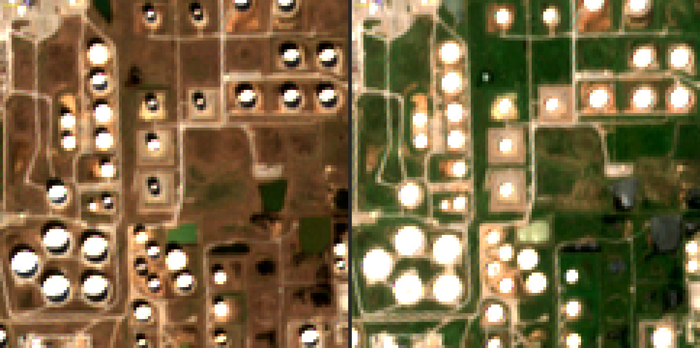

# Satellite tank shadows at Cushing: feasibility check

Exploratory work, separate from the forecasting pipeline. Findings and decision: [ADR 0008](../../pm/adr/0008-satellite-tank-shadows.md).



Left: winter. The dark crescents inside the tanks are the walls' shadows on the floating roofs, and their size varies with how full each tank is. Right: summer. The sun is too high for a visible shadow.

## Files
| File | What it is |
|---|---|
| `scenes.py` | Lists clear Sentinel-2 L2A scenes over Cushing, with sun elevation → `scenes.json` |
| `crops.py` | Reads the Cushing window from chosen scenes (cloud-optimised GeoTIFF, no full download) and saves PNG and `.npy` |
| `zoom.py` | Side-by-side zoom of the same window on two dates (`winter_vs_summer.png`) |
| `measure.py` | Shadow fraction over tank pixels for each low-sun scene, compared with EIA Cushing stocks → `measure.csv` |

## Reproduce
These scripts use extra packages that are not project dependencies, so run them in a throwaway environment:

```sh
uv run --no-project --with pystac-client --with planetary-computer --with rasterio \
  --with numpy --with pandas --with scipy --with statsmodels --with pillow \
  python research/satellite-cushing/scenes.py <data_dir>/scenes.json
```

`measure.py` also needs `<data_dir>/cushing.csv`, EIA weekly Cushing stocks exported from the project database:

```sh
uv run python -c "from datetime import date; from wedge import store, features; \
w = features.load_wide(store.connect(), vintage='latest'); \
w['cushing'].loc[date(2024, 9, 1):].dropna().to_csv('<data_dir>/cushing.csv', header=['cushing_kb'])"
```

Contains modified Copernicus Sentinel data (2024–2026), accessed via Microsoft Planetary Computer.
